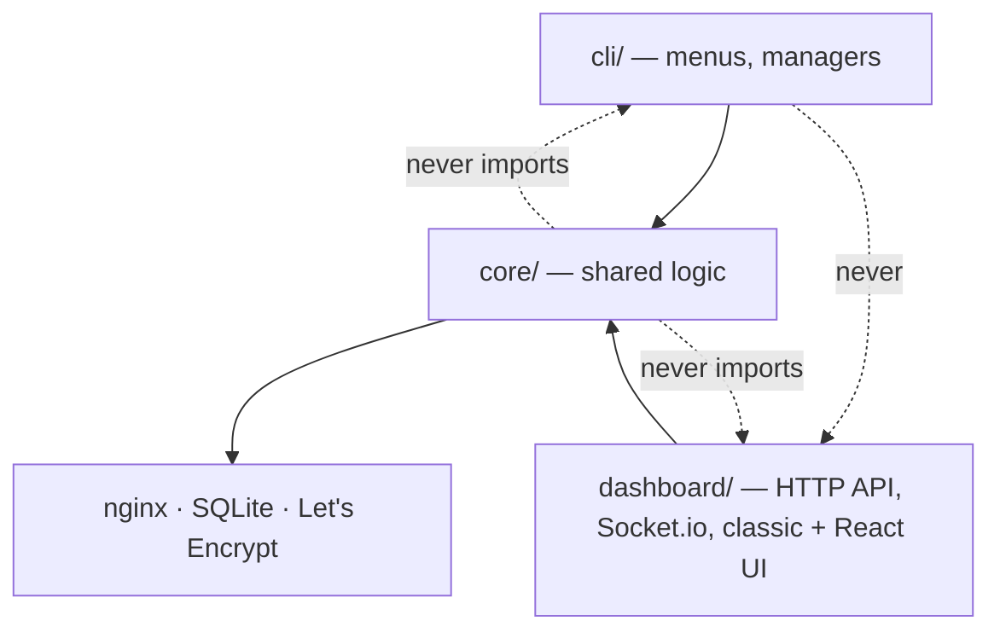
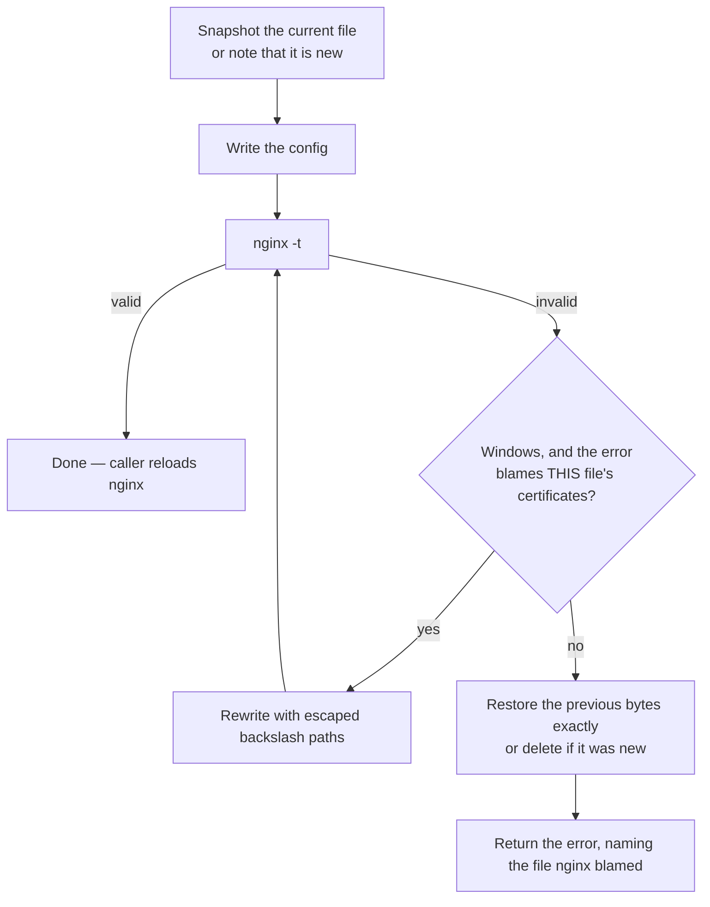
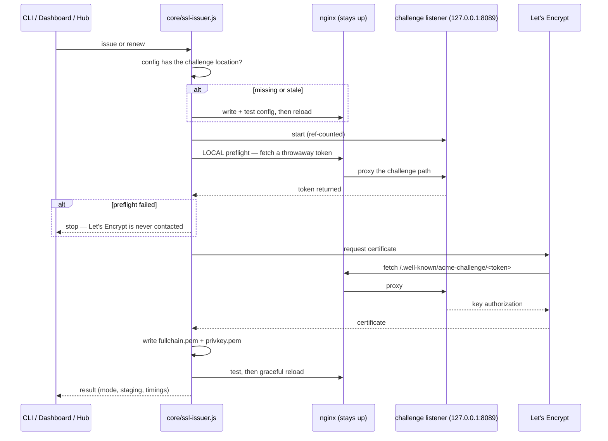
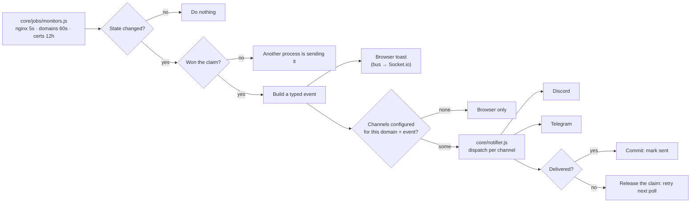
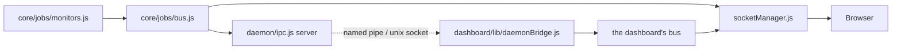
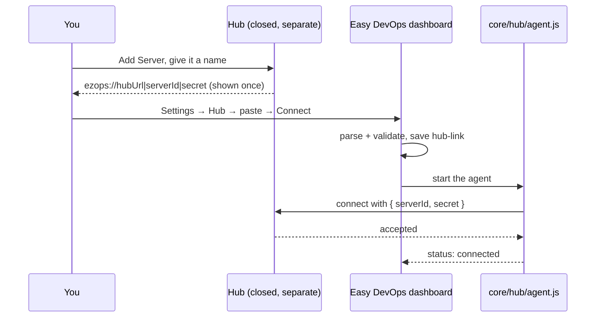
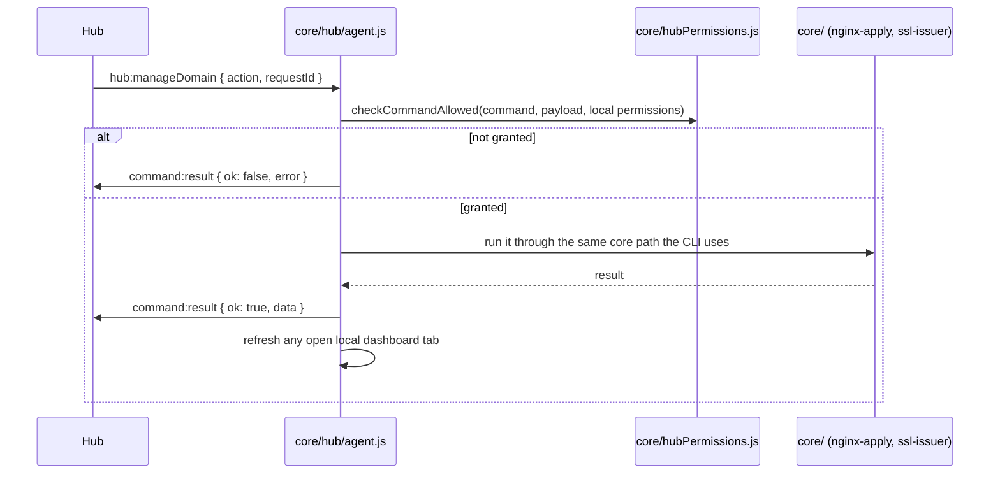

# Easy DevOps — Structure

How this codebase is organised, for someone about to work on it.

---

## What this is

Easy DevOps manages nginx, SSL certificates, domains and Node.js versions on a single server, through
an interactive terminal menu and a web dashboard.

It is for two groups:

- **People with a VPS who do not want Docker.** You have one server, you want a reverse proxy, a few
  domains and HTTPS. Containers, orchestration and YAML are more than the job needs.
- **People learning server administration.** Every action maps to something you could have typed
  yourself. The generated nginx configs are plain files you can read, edit and keep after uninstalling.

It targets **Linux and Windows**. Both are first-class; neither is an afterthought.

### Non-goals

Not a container platform, not a CI system, and not a multi-server tool on its own. Managing several
servers from one place is what the optional Hub does — see [The Hub](#the-hub-optional) below.

---

## Layout

```
src/
  core/        shared logic — the single source of truth
  cli/         interactive terminal app (inquirer menus)
  dashboard/   Express + Socket.io web app (classic EJS UI, plus the React
               dashboard source in dashboard/ui/)
  lib/         installer shell scripts
dist/ui/       built React dashboard — npm run build:ui, not committed
e2e/           plain Node test scripts (no framework)
```

### Why everything shared lives in `core/`

The CLI and the dashboard do the same things by different routes: both create domains, both issue
certificates, both control nginx. When that logic lived in two places it diverged — the dashboard and
the CLI would generate subtly different nginx configs for the same input, and a fix in one never
reached the other.

So `core/` owns the behaviour and the two front ends are consumers. A rule that falls out of this:
**if the CLI and the dashboard both need it, it belongs in `core/`.** `core/` never imports from
`cli/` or `dashboard/`.



### What lives in `core/`

| Module | Responsibility |
|---|---|
| `shell.js` | **Every** subprocess call. `run`, `runLive`, `runInteractive`, `runWithStdin` |
| `platform.js` | **Every** OS difference: paths, nginx commands, the data directory |
| `db.js` | SQLite access (`good.db`), key/value only. Reads are uncached — see below |
| `config.js` | The `config` record, merged over platform defaults |
| `nginx-conf-generator.js` | Builds nginx config text. Pure — only `generateConf()` writes a file |
| `nginx-apply.js` | Writes a config, tests it, rolls back on failure |
| `runner.js` | **Every** PM2 invocation. Detect, install, list, start/stop/restart, save, startup |
| `ssl-issuer.js` | Issues and renews certificates |
| `acme-challenge.js` | The temporary HTTP-01 challenge listener and its preflight |
| `notifier.js`, `domainNotifier.js`, `events.js`, `channels/` | Notifications |
| `notifications/claim.js`, `notifications/dispatch.js` | The one safe send path: evaluate → claim → send → commit |
| `jobs/` | The background work (monitors, revision watcher), the owner election, and `owner.js` — the exclusive jobs-ownership marker |
| `daemon/` | The single-instance lock (and its `fs.watch` watcher), the local IPC channel, and `ezz daemon` |
| `nginx-service.js`, `cert-reader.js` | nginx service control and certificate reading. Moved here from `dashboard/lib/` when the daemon needed them |
| `domains-db.js`, `cert-operations.js` | The domain store, and the certificate actions the Hub can request. Also moved from `dashboard/lib/` |
| `hub/agent.js` | The outbound Hub agent. Background work, so it follows job ownership |
| `hubLink.js` | Pairing state for the optional Hub |
| `installSource.js` | npm install, git clone or loose copy — and therefore how this copy is updated |
| `updater.js` | `ezz update`: stop, replace, refresh the Server-mode copy, start, verify, roll back |
| `cleanup.js` | The reclaimable-file inventory. Scans; deletes only what it is handed |
| `purge.js` | `ezz uninstall --purge`: back up first, then remove the service, runtime and data |
| `setupCode.js` | The one-time first-run setup code. Printed locally, stored hashed, never transmitted |
<<<<<<< HEAD
| `probeCache.js` | Cache with background refresh for probes that cost a subprocess. One PowerShell spawn is ~1 s on Windows |
=======
>>>>>>> 9238df86221d4ee97559a959817f3f21827fb07c
| `service/runtimeUpdate.js` | Moving the service onto another Node: smoke test, swap, verify, roll back |
| `validators.js`, `detector.js`, `permissions.js` | Input validation, system detection, Linux sudoers setup |

Two constraints worth knowing before you add code:

- **No subprocess outside `shell.js`.** Centralised escaping, timeouts and error handling.
- **No `process.platform` outside `platform.js`.** OS branching scattered through business logic is
  how cross-platform bugs get in.

---

## Running it

```bash
npm start            # interactive CLI
easy-devops          # same, once installed globally
ezz                  # short alias

ezz --dash             # dashboard in the foreground, prints the URL, Ctrl+C stops it
ezz --dash --classic-ui # the same, serving the old EJS page instead of dist/ui
ezz daemon             # the background worker in the foreground (no web port)
ezz service install    # install it as a native OS service
ezz --dev            # use an isolated data directory
ezz --dev --dash     # both
npm run dev          # = ezz --dev
npm run build:ui     # install and build src/dashboard/ui into dist/ui
ezz --help
```

`src/cli/index.js` is a thin bootstrap: it parses argv by hand (no `util.parseArgs`, which needs a
newer Node than the supported floor), sets the environment, then dynamically imports the real entry
point. That ordering matters — see the next section.

| Flag | Effect |
|---|---|
| `--dash` | Starts the dashboard in this terminal and skips the menu. Ctrl+C closes the HTTP server, the Socket.io server, every log tail, the background jobs it was running, the daemon bridge and the database handle |
| `--dev` | Points `EASY_DEVOPS_DATA_DIR` at `.dev-data/` in the project. Also forces Let's Encrypt **staging** |
| `--classic-ui` | Serves the old EJS page instead of the React build in `dist/ui`. Overrides the `dashboardUi` setting for this run. A temporary fallback |
| `--new-ui` | Accepted and ignored — the React UI is the default. Prints a note saying so |
| `--purge` | With `uninstall`: actually remove Easy DevOps. Without it, `uninstall` only explains the difference from `service uninstall` |
| `--days N` | With `cleanup`: the age at which a log counts as reclaimable (default 14) |
| `--yes` | Answers the confirmations. `cleanup --yes` touches only the unambiguous groups — never a Node version, never PM2 |

### Commands that only exist in the CLI

| Command | Why not the dashboard or the Hub |
|---|---|
| `ezz update` | It replaces the running package and stops the service, so the process serving the request is the one being replaced. `whyCliOnly()` in `core/updater.js` is what tells the user that |
| `ezz runtime update` | Installing a Node version takes minutes of streamed output, and a Windows Server swap needs an Administrator terminal the dashboard cannot obtain |
| `ezz uninstall --purge` | It deletes the database the dashboard reads |
| `ezz dashboard setup-code` | The code's purpose is to prove the caller can read this machine's terminal. An endpoint that handed it out would defeat it |

---

## Where data is stored

One function decides: `getDataDir()` in `core/platform.js`.

```
EASY_DEVOPS_DATA_DIR   → use it verbatim
Windows                → %APPDATA%\easy-devops
Linux / macOS          → ~/.config/easy-devops
```

That directory holds the SQLite database, dashboard sessions, and the dashboard log.

**Never inside the package directory.** `npm update` replaces the package folder; anything stored
there is destroyed. An older version did exactly that and lost user configuration on every update.

`--dev` sets `EASY_DEVOPS_DATA_DIR` **before anything imports `db.js`**. ES modules evaluate all
static imports before any module body runs, so by the time `index.js` executed a line, `db.js` would
already have resolved its path. That is why `index.js` has no static import that reaches `db.js`, and
why child processes (such as the detached dashboard) inherit the variable automatically.

Dev mode also **skips the legacy data migration**. That migration renames an old database file, so
running against a scratch directory would otherwise consume the real installation's data.

### SQLite keys

`good.db` is a key/value store, not a relational database. The keys in use:

| Key | Contents |
|---|---|
| `config` | Paths, ports, ACME settings |
| `domains` | Array of domain objects (v2 schema) |
| `system-detection` | Cached OS / nginx / Node detection |
| `session_secret` | Dashboard session secret, generated once |
| `notification_channels` | Named Discord/Telegram channels |
| `domain_notification_config` | Per-domain event routing |
| `notification_state` | Deduplication and recovery state |
| `hub-link`, `hub-permissions` | Hub pairing (see below) |

---

## Nginx configuration

`core/nginx-conf-generator.js` turns a domain object into config text. It is pure: the only function
that touches the filesystem is `generateConf()`.

Writing is always done through **`writeConfWithTest()`** in `core/nginx-apply.js`:



The CLI, the dashboard API and the Hub command path all call this one function, so a failed write
cannot leave a broken config behind in one of them and not the others.

**Validity is checked with `isNginxTestOk()`, never a raw exit code.** Without root, nginx exits 1
after printing `syntax is ok`, because it cannot write its PID file. Checking the exit code alone
reports a valid config as broken.

### Windows paths

nginx's config lexer treats `\` as an escape character, so `C:\nginx\test\certs\cert.pem` has its
`\n` and `\t` read as a newline and a tab. Whether a config loads therefore depended on the folder
names — one starting with `n`, `r` or `t` broke it, others did not.

Certificate paths are written with **forward slashes** on Windows (`C:/nginx/...`), which the lexer
leaves alone. Quoting alone does not help: `"C:\nginx\..."` fails the same way. The escaped form
`"C:\\nginx\\..."` also works and is used as a fallback. On Linux these helpers are identity
functions and the output is byte-for-byte unchanged.

Existing configs are never rewritten automatically. Domains still holding backslash paths are
reported, and saving such a domain regenerates it.

---

## SSL certificates

### HTTP-01 without stopping nginx

Every generated port-80 server block forwards the ACME challenge path to a loopback listener that
Easy DevOps starts only for the duration of an issuance:

```nginx
location ^~ /.well-known/acme-challenge/ {
    proxy_pass http://127.0.0.1:8089;
}
```

Two details make this work:

- **`^~`** is a prefix match that wins outright, so neither `location /` nor any regex location can
  intercept the challenge.
- **The HTTP→HTTPS redirect lives inside `location /`, not at server level.** nginx runs a
  server-level `return` during the rewrite phase, *before* location matching, so a server-level
  redirect answers the challenge with a 301 no matter what locations exist.

A domain with SSL enabled and the redirect disabled still gets a port-80 block that serves only the
challenge and 404s everything else — otherwise it would have no port-80 listener at all and could
never renew over HTTP.



### The preflight

Before contacting Let's Encrypt, Easy DevOps serves a throwaway token and fetches it back **through
nginx, on this machine**. A failure costs nothing against the rate limits.

It probes the address nginx actually listens on. A config that binds `listen 203.0.113.5:80` is not
reachable on loopback, so probing `127.0.0.1` would look like a broken setup when nothing is wrong.
Wildcard listens (`listen 80`, `listen [::]:80`) are probed on loopback; a specific address is probed
as bound.

### Modes

`sslChallengeMode` is `auto` (default), `proxy`, or `standalone`.

In `auto`, proxy mode runs first. **Only a failed local preflight may trigger the standalone
fallback — never a Let's Encrypt failure.** Falling back after a rejection would spend a second
attempt on a problem that is not about the challenge method.

Standalone stops nginx, binds port 80 directly, and restores nginx in a `finally` block, verifying it
came back. The result reports which mode ran, whether it fell back, and how long nginx was down.

If both modes fail, the error says the cause is probably outside Easy DevOps — DNS not pointing here,
port 80 firewalled, an AAAA record pointing elsewhere, or a CDN forcing HTTPS — and includes what the
preflight saw.

### Wildcards and staging

Wildcard certificates require **DNS-01** and never touch nginx: you add a TXT record and confirm.

`acmeStaging` switches to the Let's Encrypt staging directory, and **dev mode turns it on
automatically**, so development cannot consume production rate limits. Staging certificates are not
trusted by browsers — that is expected.

`acmeChallengePort` defaults to `8089` and must be free. If it is busy, issuance fails with a clear
message rather than silently choosing another port.

---

## Notifications

Three event types, defined in `core/events.js`:

| Event | Fires when |
|---|---|
| `nginx_down` | nginx stops, and again when it recovers |
| `domain_health` | A domain's backend stops answering, and again when it recovers |
| `cert_expiry` | A certificate is within 30 days of expiry |

Channels are named records in SQLite — Discord webhooks or Telegram bots — created once in
**Settings → Notifications** and reusable across domains. Each channel type is a module in
`core/channels/` exporting one `send(event, channelConfig)` function; adding a type means adding a
file. A channel that throws is caught and logged, so one broken webhook cannot block the others.

Routing is per domain: each domain decides, per event type, which channels receive it. An empty
channel list means browser-only.

`evaluateTransition()` in `core/domainNotifier.js` is a small state machine that suppresses
repeats: it notifies on the transition into a state, stays quiet while the state holds, and notifies
again on recovery. State is persisted, so a restart does not re-announce everything.

It is **pure** — it records nothing. That matters: the old
`shouldSendNotification()` wrote "notified" to the database *before* the
notification was sent, so a webhook that was down meant the state already
claimed it had gone out and it was never retried. The order is now
evaluate → claim → send → commit, in `core/notifications/dispatch.js`, and a
failed send releases the claim so the next poll tries again.

The claim (`core/notifications/claim.js`) is what makes this safe while a
daemon and a dashboard are briefly both running the monitors: it is an atomic
`open(path, 'wx')` in the data directory, so exactly one process wins the
transition. A file rather than a database row because `good.db` offers only
get/set — no compare-and-swap — and raw SQL is prohibited; "write my pid then
read it back" is not an election, because two processes can interleave and both
see their own pid.



---

## The dashboard

Express + Socket.io. Two UI implementations share the same API, and the server
chooses one at startup:

- **new** (default) — the React app in `ui/`, built by `npm run build:ui` into
  `dist/ui/` at the repository root. The build is shipped in the published
  package and is never required to run from a source checkout.
- **classic** — EJS templates plus first-party Vue in `public/js/app.js`. No
  build step. A temporary fallback, kept so an operator who hits a regression
  in the new UI has a working dashboard in the same minute.

Selection is the `dashboardUi` setting (`new` | `classic`, read on each start,
so a background service can pick it up) or the `--classic-ui` flag, which wins
for that run. In new mode `dist/ui` is served at `/` with an `index.html`
fallback for deep links; `/api` and `/socket.io` are mounted identically in
both modes. A missing build prints the build command and falls back to classic,
never a failed start. The daemon serves no UI at all.

```
dashboard/
  server.js          app wiring, sessions, UI selection, standby jobs, shutdown()
  socketManager.js   Socket.io: forwards bus events, owns the live log tails
  routes/            thin — path → controller method
  controllers/       request handling
  lib/               auth gate, local-request checks, daemon bridge
  views/             EJS (classic)
  public/js/app.js   Vue app (classic)
  ui/                React dashboard source (Vite, separate package)
dist/ui/             React build output (published, gitignored)
```

The dashboard is **not** where background work happens. nginx polling, domain
health, certificate checks, notifications and the Hub agent live in
`core/jobs/` and run in whichever process owns them — the daemon when one is
running, otherwise the dashboard while it is open. See "The daemon" below.

Routes are deliberately thin. Logic belongs in a controller, and anything the CLI also needs belongs
in `core/`.

`shutdown()` in `server.js` is idempotent and releases every handle, which is what makes `ezz --dash`
exit cleanly on Ctrl+C.

---

## The daemon

`ezz daemon` is the background worker: monitoring, notifications, the domain
revision watcher and the Hub agent. It runs in the **foreground** and opens
**no HTTP port**.

Both of those are deliberate. Foreground, because every service manager this
project targets — WinSW, systemd, the Windows Startup supervisor — wants a
process it can start, watch and stop; one that forks into the background looks
to them like an immediate crash. No port, because the daemon monitors rather
than serves: a port would need its own bind policy, authentication and firewall
story, all of which the on-demand dashboard already has.

```
core/
  daemon/
    lock.js            single-instance lock: pid + heartbeat, plus watchLock()
    ipc.js             named pipe (Windows) / Unix socket, server → client only
    run.js             ezz daemon
  jobs/
    bus.js             in-process event channel (api-contract event names)
    monitors.js        nginx status, domain health, cert expiry
    revisionWatcher.js notices changes made by another process
    owner.js           who runs the jobs RIGHT NOW: claim, heartbeat, release
    index.js           startJobs({ role }) — the owner election
  notifications/
    claim.js           atomic cross-process claim
    dispatch.js        evaluate → claim → send → commit
  hub/agent.js         the outbound Hub agent (background work, follows ownership)
```

### Exactly one owner

| Process | Lock | Runs the jobs |
|---|---|---|
| `ezz daemon` | takes it | always, while it holds the lock |
| `ezz --dash` | never takes it | only while no daemon holds it |

The dashboard **watches** the lock file and also polls it every 15 seconds, and
hands over in either direction. It deliberately does not take the lock itself —
otherwise `ezz daemon` would refuse to start while a browser tab was open, and
installing the service would mean closing your dashboard first.

The watch is `fs.watch` on the data **directory**, not on the lock file: the
file does not exist when no daemon runs, and that absence is exactly the state
a watcher has to see change.

A lock is treated as dead only when the heartbeat is stale **and** the pid is
gone. Either alone is not enough: a crashed daemon leaves its pid behind and
the OS eventually reuses that number, while a daemon paused at a breakpoint or
a machine resumed from sleep has a stale heartbeat but is still running.

### The hand-over is exclusive

A window where both sides run the monitors is **not** acceptable, and one poll
interval of it was what the design used to allow. Two processes each with a Hub
agent connected for the same `serverId` make the Hub evict them in turn, so the
server flapped between connected and disconnected for as long as the overlap
lasted.

Two things close it, and both are needed:

| | |
|---|---|
| The dashboard sees a daemon **at once** | `watchLock()`, rather than up to 15s of polling |
| The daemon **waits** to be handed the jobs | `core/jobs/owner.js` — a marker separate from the lock, because the dashboard never takes the lock |

The marker carries a pid and a heartbeat. The owner claims it before starting
anything and releases it **last**, after the Hub agent and the monitors are
down. A starting daemon waits for it to be free, bounded by `HANDOVER_WAIT_MS`;
on timeout it starts anyway and logs why, because a daemon that monitors
nothing is worse than a brief overlap.

The notification claim remains the backstop for the window that cannot be
designed away: even with two runners, a transition is sent exactly once.

### How events reach the browser

One path, whichever process produced them:



`service:changed` is published by the dashboard side rather than by a monitor:
the bridge watches the lock, and whenever the answer to "is the background
service running, and who owns the jobs" changes it puts the whole state on the
bus — once per real change, so an ordinary restart does not flicker the banner.
`socketManager.js` caches it, along with `nginx:status` and `domain:health`, and
replays it to each new connection; a tab that opens while the service is
already running must render the banner immediately rather than wait for the
next hand-over to tell it anything.

The IPC channel carries events **only**. The server accepts no commands and
drains whatever a client writes. That is a security boundary, not an omission:
the daemon may run as a Windows service account with access the dashboard user
does not have, and a named pipe's default ACL is more permissive than people
expect. Changes travel the other way through the `hub-revision` counter in
SQLite, which every process already polls.

### Installing it as a native OS service

`ezz service install | uninstall | status | restart | logs | repair`.

| platform / mode | mechanism | elevation | starts |
|---|---|---|---|
| Linux | systemd unit | sudo once | at boot |
| Windows "Server" | Windows Service via WinSW | UAC once | at boot |
| Windows "Personal" | Startup-folder supervisor | none | at logon |

**No password is ever requested, stored or seen.** sudo asks for its own on the
user's terminal; the Windows service runs as the virtual account
`NT SERVICE\EasyDevOps`, which has none. The previous design used a Task
Scheduler task that needed the user's password — that mode is gone, and
`core/service/legacy.js` finds and offers to remove what it left behind
(the `ez-dashboard` PM2 app, the `EasyDevOps-PM2` task, the old launcher).
It never touches PM2 apps that are not ours.

```
core/service/
  index.js           the dispatcher: decides the mechanism, sequences the steps
  systemd.js         the Linux unit
  windowsService.js  Server mode, via WinSW
  windowsPersonal.js Personal mode: the logon supervisor
  winsw.js           the pinned, hash-verified wrapper + the service XML
  runtime.js         pinning Node so a version manager cannot break the service
  acl.js             the Windows service account's permissions
  dataDir.js         the ProgramData migration
  legacy.js          finding and removing the old PM2 setup
```

Three things here are easy to get wrong and are therefore decided once:

**A service manager reporting "started" is not a running daemon.** WinSW and
systemd both report success as soon as a process is spawned, so a daemon that
throws on startup is reported as started and then restarted for ever. After
starting, the install waits for the daemon's own heartbeat and reports FAILED
with the last log lines if it never arrives. `status` flags a crash loop from
`NRestarts` on Linux and from WinSW's wrapper log on Windows — `sc query`
reports RUNNING between restarts, so it cannot see one.

**The Node runtime is pinned,** or `nvm install 22` breaks the service weeks
later with a "file not found" in a log nobody is watching. A symlink on Linux
(so `repair` re-points it instead of editing a unit), a copy into admin-only
ProgramData on Windows Server (the service account may not be able to read the
user's profile, and `npm update` replaces the package directory under a running
service), and a recorded absolute path in Personal mode, which `status` checks.
`better-sqlite3` is a compiled addon, so a runtime is verified by **loading it**
with the target binary rather than comparing ABI numbers — a half-copied
`node_modules` passes a number check and fails at load.

**The Windows service's permissions come from Settings.** `nginxDir` and
`sslDir` are whatever the user configured; granting a hardcoded `C:\nginx`
would hand a service account write access to a directory nobody pointed us at,
while the real one stayed unreadable. The granted paths are recorded and
compared on every `status`, so changing one in Settings produces a clear
"run `ezz service repair`" rather than a service that quietly stops working.

In Server mode the data directory becomes `C:\ProgramData\easy-devops` for the
service, the CLI and the dashboard alike, migrated once with a verified copy
and a backup. **Uninstall never silently moves it back**: it asks, defaulting
to keeping the server location, because that directory then holds the live data.

---

## The Hub (optional)

The Hub is a **separate, closed-source product** for watching several servers from one place. Easy
DevOps works fully without it, and nothing in this repository depends on it being reachable.

This section describes only what the agent in this repository does. The Hub's own internals are not
part of this project.

### Pairing

The Hub generates the connection string; this server consumes it.



Nothing connects until a valid string is saved. The string is a credential: it is stored so the agent
can authenticate, and is never shown again by the dashboard or returned by any API.

`core/hubLink.js` owns all of this — parsing, validation, storage, permissions, and the classification
of handshake failures — so a future CLI pairing menu reuses the same logic.

### What the agent sends

Outbound only. The server opens the connection; no inbound firewall change is needed.

| Event | Interval |
|---|---|
| `nginx:status` | 5s |
| `server:resources` (CPU, RAM, disk) | 30s |
| `domain:health` | 60s |
| `domain:configs` | 5 min, plus on connect and on every change (the full list) |
| `service:state` | 5 min, plus on connect and on every change |
| `processes:list` | 60s |
| `channels:list` (names and types only) | 5 min |
| `cert:expiry` | 12h |
| `server:info` | on connect |

### What the agent accepts

Each command maps to a permission the operator grants on this server. The
catalog lives in `core/hubPermissions.js` and is the single source of truth:
the dashboard renders the tree from it, and the agent re-checks every incoming
command against it.

| Group | Permissions |
|---|---|
| **Nginx** | start, stop, restart, reload, test, view configs, edit configs, view logs |
| **Domains** | create, edit, enable/disable, delete |
| **SSL** | renew one, renew all expiring, issue new, delete |
| **System** | *(coming soon)* Node.js versions, reboot |

Marked **coming soon** and visible but not enableable: wildcard issuance from
the Hub (DNS-01 needs a TXT record you add by hand), Node.js version
management, and server reboot.



**Permissions are granted on this server, default to off, and are re-checked on
every command.** The Hub holds a copy so it can grey out buttons, but that copy
is a hint — it cannot grant anything. Turning a toggle off stops those commands
locally whatever the Hub sends.

Enabling a group enables all its children; a group with only some children on
shows as partial. Monitoring — metrics, nginx status, the domain list, health
and certificate expiry — is always on and is not a permission: a paired server
is a monitored server, and gating read-only telemetry would protect nothing.

## PM2 and the user's own applications

> **This section is history for Easy DevOps itself.** It used to keep itself
> alive through PM2; it now runs its own daemon under a native OS service —
> see [The daemon](#the-daemon) above. What remains true is everything below
> about how PM2 behaves, because `core/runner.js` and the **Processes page**
> still manage the user's OWN applications, which is a supported feature.
>
> `core/service.js` has been **deleted**. Service state now comes only from
> `core/service/index.js` — `backgroundServiceState()` for the cheap read and
> `status()` for the full one — and the old boot hooks are described by
> `core/service/legacy.js`, which exists to offer to remove them.
>
> The Windows "at boot" mode described below needed the user's **password**,
> stored in Task Scheduler. That is the specific reason the whole approach was
> replaced: nothing in Easy DevOps asks for a password any more.

The PM2 app is **ez-dashboard**, or **ez-dashboard-dev** when a dev data
directory is in use, so a developer's instance can never stop the real one.
It runs `src/cli/index.js --dash` — the script path, not the `ezz` shim,
because on Windows that shim is a `.cmd` PM2 cannot run as a Node script.

### Start on boot

| Platform | Mechanism | Credentials |
|---|---|---|
| Linux / macOS | `pm2 startup`; the root command is **printed, not run** | none stored, no sudoers rules |
| Windows — personal/dev | Hidden launcher in the Startup folder running `pm2 resurrect` | none; logon only, stops at sign-out |
| Windows — server | Task Scheduler task at system startup, same user, 30s delay | **Windows** prompts and stores it |

`pm2 startup` has no Windows support, which is why Windows has its own two
paths. The server-mode task is created with `schtasks /RP *` so Windows
collects the password itself: it never reaches Easy DevOps, in any form. That
requires an elevated, interactive terminal, so **server mode is CLI-only** —
the dashboard can report the status but not create the task.

The Windows launcher is a `.cmd`, not the traditional `.vbs`: VBScript is
deprecated and slated for removal from Windows. The cost is a brief console
flash at logon.

### Two rules worth knowing

**A status read never starts the PM2 daemon.** Every pm2 command, including
`pm2 --version`, starts it. `service.status()` checks the daemon's pid file
first and skips PM2 when it is down — otherwise opening the dashboard, or the
Hub agent reporting in, would spawn a PM2 daemon on a machine that does not use
PM2.

**PM2 is per-user on Linux, machine-wide on Windows.** On Linux and macOS each
OS user gets their own daemon and process list under `PM2_HOME`, so a service
installed by another account is invisible and uncontrollable from elsewhere.
Every surface reports such a mismatch rather than silently failing.

**On Windows, `PM2_HOME` does not isolate anything.** PM2's daemon there is
reached over named pipes whose names are fixed, not derived from `PM2_HOME`, so
every PM2 invocation on the machine talks to the *same* daemon and the *same*
process list regardless of what `PM2_HOME` is set to. Measured directly:
starting an app with `PM2_HOME` pointed at a temporary directory, then running
`pm2 jlist` with no `PM2_HOME` at all, lists that app.

Two consequences:

- Setting `PM2_HOME` on Windows is not a sandbox. Anything that would be unsafe
  against the real PM2 is unsafe with it set.
- `e2e/service.test.mjs` therefore does **not** use real PM2. It writes a stub
  `pm2` executable into its temp directory and asserts, before every command,
  that the pm2 being invoked is that stub. The guard is on the command, not on
  an environment variable, precisely because the environment variable is not
  load-bearing.

**Start-on-boot is shared.** One systemd unit, one scheduled task, one Startup
launcher — each simply runs `pm2 resurrect`, which restores *every* saved app.
`ezz service uninstall` therefore removes its own app and re-saves, but only
tears down the boot mechanism when PM2 has no other apps left; otherwise it
keeps it and says which apps it is protecting.

**Detecting start-on-boot never runs `pm2 startup`.** That command is not a
query: given the rights to act it installs the hook, so using it to read state
would silently enable start-on-boot during a status check (and start the PM2
daemon as a side effect). `bootStatus()` reads `systemctl is-enabled
pm2-<user>` instead, and reports *unknown* rather than guessing on systems that
do not use systemd.

### Keeping both sides current

| Direction | Mechanism |
|---|---|
| Permissions → Hub | Pushed the moment they change, and on connect |
| Hub → this dashboard | After the agent applies a command, open browser tabs refresh just the affected section |
| Dashboard or CLI → Hub | A revision counter in SQLite, bumped on every domain or certificate change. The agent checks it every few seconds and pushes only when it moved |

The counter exists because the CLI is a separate process from the dashboard
(where the agent lives), so an in-process event cannot reach it. A small
integer read is cheap, and it replaced a five-minute heartbeat.

For the same reason **`core/db.js` runs with `good.db`'s read cache disabled**.
That cache is a plain in-process LRU with no TTL and no cross-connection
invalidation: the first `get` of a key was returned for the life of the
process. With several processes on one database file, the agent's revision
poll kept reading the counter it saw at startup and never noticed the CLI
moving it, so CLI-side changes never reached the Hub at all. Reading straight
from SQLite costs ~50us for a scalar key and ~150us for the whole domain list.

`domain:configs` carries the **complete** domain list and the Hub treats it as
a replace: it deletes rows whose names are absent in the same transaction that
adds and updates the rest. That is what makes a deletion (and a rename)
propagate, and it means a stale "ghost" domain in the Hub is cleaned up as soon
as the agent reconnects. The Hub then emits the new set to the browser room, so
an open Hub page updates without a reload.

Domains are written through `saveDomains()` by every path — dashboard API, CLI,
hub command and backup restore — because that is the one place that bumps the
revision counter. A bare `dbSet('domains', ...)` would skip it.

Every command carries a `requestId`, and the agent replies with
`command:result`, so the Hub reports what actually happened rather than
assuming success.

### Statuses

Shown in Settings → Hub:

| Status | Meaning |
|---|---|
| `not_linked` | No connection string saved |
| `connecting` | Socket open, handshake not finished |
| `connected` | Authenticated and streaming |
| `rejected` | The Hub refused the credentials. **Retrying stops** — paste a new string |
| `unreachable` | Network or transport failure. Retries with backoff, capped at 60s |

The split matters: retrying forever against a rejected secret is noise, while a hub that is simply
down should be waited for. A rotated secret produces `rejected`, with a message saying to paste the
new connection string.

---

## Testing

There is no test framework here, by design — the project runs as plain ESM with no build step, and a
runner would be one more thing to maintain. `e2e/` holds plain Node scripts with no dependencies:

```bash
node e2e/ssl-challenge.test.mjs   # challenge location, preflight, real nginx proxy
node e2e/ssl-path.test.mjs        # Windows certificate path handling
node e2e/hublink.test.mjs         # pairing state machine
node e2e/pairing-smoke.test.mjs   # full stack; refuses to run if ports are in use
```

Each isolates itself with a temporary `EASY_DEVOPS_DATA_DIR` and asserts afterwards that the real
data directory was untouched.

---

## Conventions

- **Pure ESM, no build step.** Node 18+. No TypeScript, no bundler. Vue comes from a CDN.
- **No new dependencies** without a good reason.
- `run()` returns `{ success, stdout, stderr, exitCode }` and never throws — check `success`.
- `systemctl` from the dashboard uses `sudo -n` with the full `/usr/bin/systemctl` path, matching the
  sudoers rules written by `core/permissions.js`.
- Errors are returned as structured objects (`step`, `cause`, `consequence`), not thrown strings.

The project's binding rules live in `.specify/memory/constitution.md`. Read it before changing
anything in `core/`.
